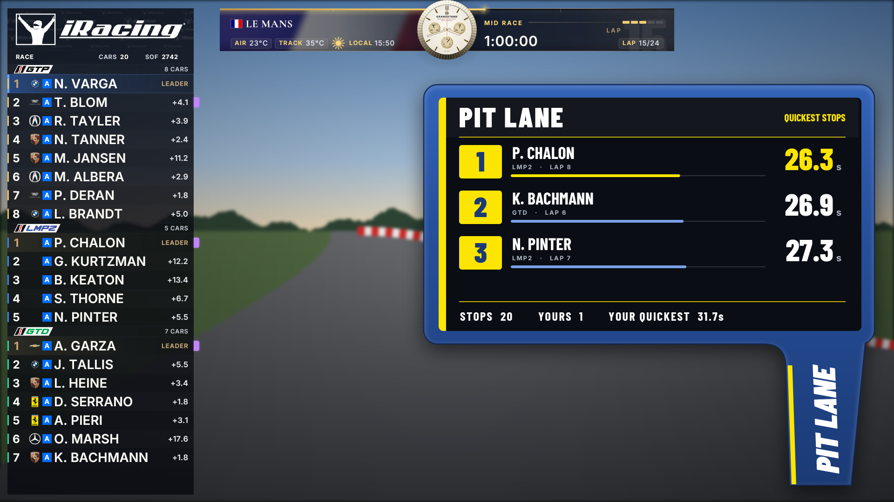
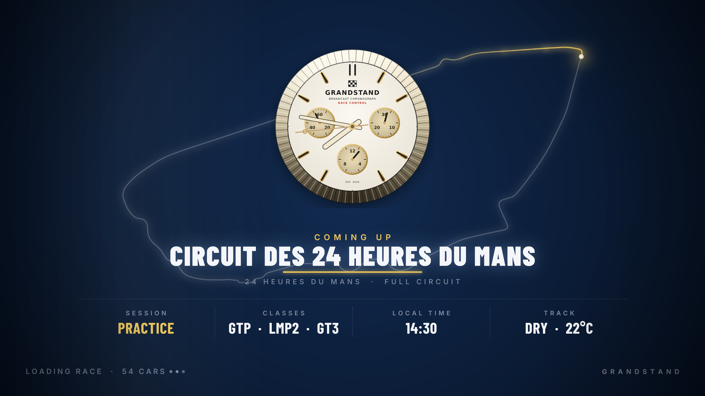
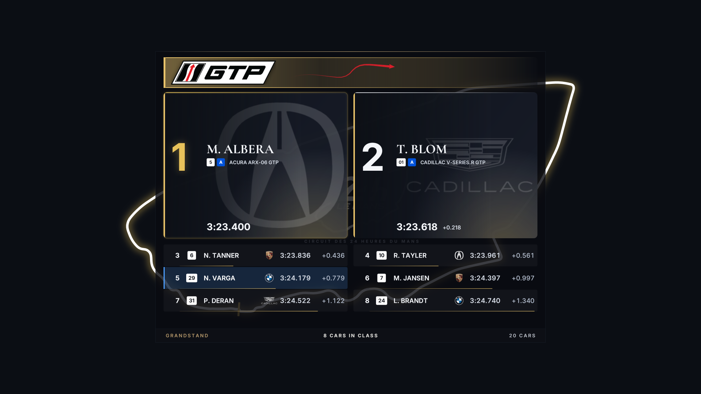
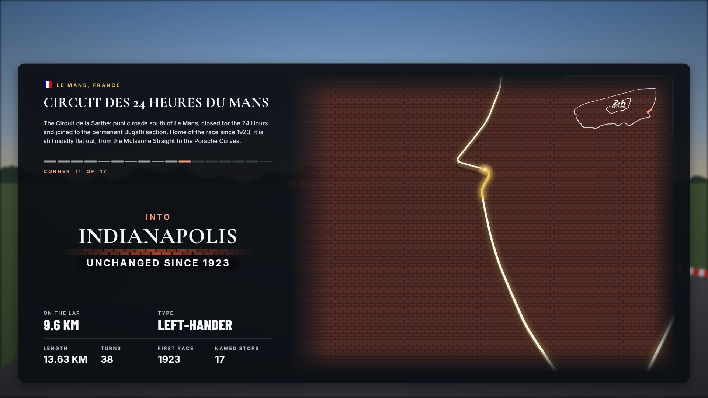
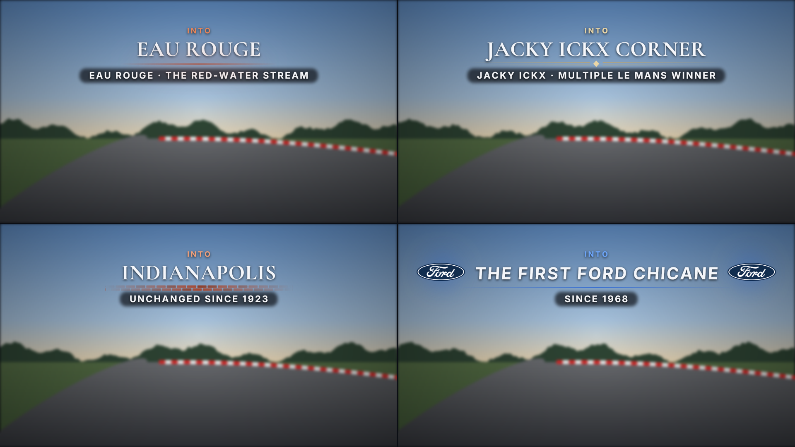
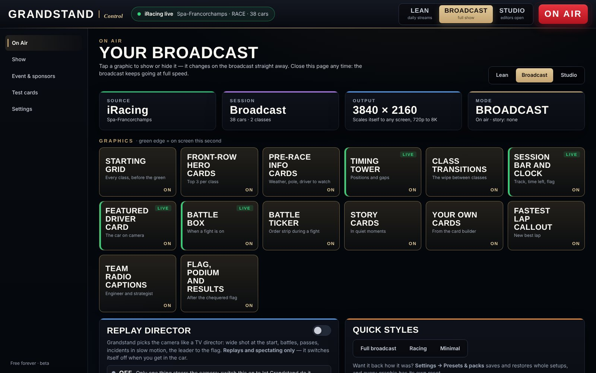
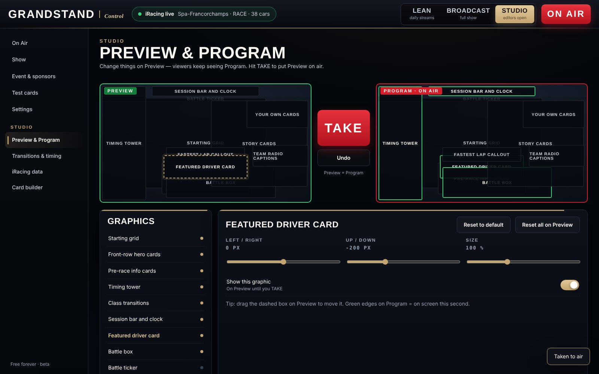
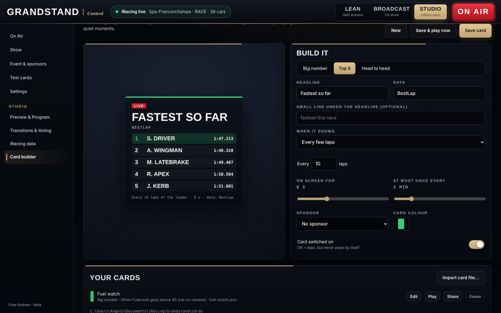
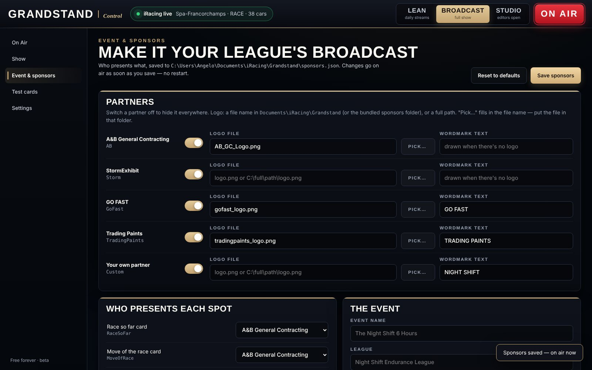

<div align="center">

# GRANDSTAND

**TV-style broadcast graphics for your iRacing races. Built in 4K, scales to 8K and cinema screens. Free, forever.**

[](#why-its-free)
[](../../commits)
[](LICENSE)
[](#4k-and-beyond-from-a-stream-to-a-cinema-screen)
[](#getting-it)

</div>

---

## Hey, I'm the guy who made this

I race the BMW M4 GT3 and the M Hybrid V8 on iRacing, and I always wanted my races to look like the real thing on TV. The globe spinning to the circuit, the starting grid, the timing tower, the little cards that pop up when somebody pits or sets a fastest lap. The stuff that makes a 45-minute sprint feel like Le Mans.

So I built it. And I'm giving it away.

I don't like people charging for this kind of stuff and getting an advantage just because they have the money. So Grandstand is free. No paid tier, no "pro version", nothing locked. If you race on iRacing, it's yours.

> **It's in beta and it's updated frequently.** Things will change fast. If something breaks, [tell me](../../issues/new/choose).


---

## What it does

- **A real opener for every track.** The globe spins to the circuit, the logo lands and the track draws itself in, like a TV broadcast.
- **Starting grid, class by class.** Front row up top, the whole field underneath, for every class in the race.
- **Live timing tower.** Positions, gaps and classes, ordered by where cars are on track, plus a box for the car you're watching.
- **Driver to watch.** Car, starting spot, iRating and licence, pulled straight from the session.
- **Story cards.** Fastest laps, pit stops, places gained, off-tracks, halfway, track temperature. They show up when something actually happens.
- **Battle cards, podium and final results**, with fastest lap, biggest mover and the cleanest race.
- **Your own look.** Pick a watch face for the broadcast clock, drop in your own transition rollers, car pictures, sounds or partner logos.



<table>
<tr>
<td width="50%"><br><b>Loading splash</b><br>The broadcast watch, the circuit and the session at a glance while iRacing loads.</td>
<td width="50%"><br><b>Starting grid</b><br>Class by class, front row up top.</td>
</tr>
<tr>
<td><br><b>Track card</b><br>The story of the circuit, then a walk round the lap, corner by corner.</td>
<td><br><b>Corner labels</b><br>Every named corner, with where its name comes from.</td>
</tr>
</table>

<sub>Screenshots use made-up drivers and data.</sub>

---

## Run your own broadcast

Open the control page in your browser while Grandstand runs. Anyone can tinker; **Studio** mode gives you the full control room. Closing the page costs the overlay nothing.

<table>
<tr>
<td width="50%"><br><b>On Air</b><br>Big buttons to show or hide every graphic, Lean / Broadcast / Studio modes, and the replay director switch.</td>
<td width="50%"><br><b>Preview and Program</b><br>Change things on Preview, then hit <b>TAKE</b>. Viewers only see it when you're ready.</td>
</tr>
<tr>
<td><br><b>Card builder</b><br>Make your own cards from iRacing data, with rules like "gains 4 places in 3 laps, show for 8 seconds". Save them and share them.</td>
<td><br><b>Event and sponsors</b><br>Put your league's partners on the "presented by" spots. Changes go live without a restart.</td>
</tr>
</table>

**Replay director.** Watching a replay or spectating? Switch it on and Grandstand picks the cameras like a TV director: the wide shot at the start, cuts between the cars in a battle, passes, slow-motion crash replays, the leader to the flag. It switches itself off the moment you get in the car.

### Track openers

Le Mans, Spa, Suzuka, Silverstone, Daytona, Road Atlanta, COTA, and more on the way.

---

## 4K and beyond: from a stream to a cinema screen

Grandstand is built at **4K (3840×2160)**, but it isn't stuck there. The graphics are drawn live by the computer, not stretched from pictures, so they scale **up as far as your screen goes**:

| Where it's going | Size |
|---|---|
| Streams and YouTube | 720p, 1080p, 1440p |
| 4K TV and 4K broadcast (UHD) | 3840×2160 |
| Cinema 4K (DCI, movie theatre projectors) | 4096×2160 |
| 5K, 6K and 8K screens and video walls | up to 7680×4320 and beyond |

Text and lines stay razor sharp at every size. Nothing gets cut off, and you don't have to move anything for your stream, recording or projector settings. (The few photo-based pieces, like car artwork and the globe imagery, are as sharp as their source pictures.)

---

## Leagues, events and sponsors

**Want your league broadcast?** I also produce league broadcasts with Grandstand and the replay director: your logo and sponsors on screen, the battles followed, every class winner shown. Email **[instabilitycontrol@gmail.com](mailto:instabilitycontrol@gmail.com?subject=EVENT)** with **EVENT** in the subject line.

**Running a league or a special event?** I can make custom overlays for it: your logo, your colours, your series name on the openers, grid and results. I want to partner with leagues and events that make sim racing better.
📧 Email **[instabilitycontrol@gmail.com](mailto:instabilitycontrol@gmail.com?subject=EVENT)** with **EVENT** in the subject line.

**Want your brand on the broadcast?** Story cards like *Fastest Laps*, *Pit Lane* and *Weather Watch* each have a "presented by" spot for a sponsor.
📧 Email **[instabilitycontrol@gmail.com](mailto:instabilitycontrol@gmail.com?subject=SPONSOR)** with **SPONSOR** in the subject line.

Partners and sponsors help keep Grandstand free. They never get anything that locks features away from other people.

---

## Coming next

- **Replay camera sets.** Ready-made camera packages for making your own race videos. A VR set (no zoom, since VR can't zoom) and a flat-screen set, to go with the replay director.
- More tracks, more cards, more polish. Check [the roadmap](WORLD_CLASS_ROADMAP.md).

## Getting it

Download the latest beta from the [Releases](../../releases) page. You'll need Windows and iRacing.

Building it yourself:

```
cd src
dotnet build
dotnet run --project ApexHUD.Native.Overlays
```

## Found a problem? Got an idea?

Use [Report a problem](../../issues/new/choose). I read reports in batches, so it might take a bit, but I read every one.

## Why it's free

Because racing should be about who's fastest, not who paid the most. If you want to help keep it going, there's a **Sponsor** button at the top of this page (Ko-fi or PayPal). Donations don't unlock anything. Everybody gets the same thing.

## Also from me

**[Instability Control](https://github.com/instabilitycontrolracing/instability-control)** is a free race engineer, strategist and spotter for iRacing that talks to you on the radio.

---

<sub>Grandstand isn't affiliated with or endorsed by iRacing, IMSA or any series, track, team or manufacturer. Their names and logos belong to their owners and are only shown to identify the real-world events.</sub>
